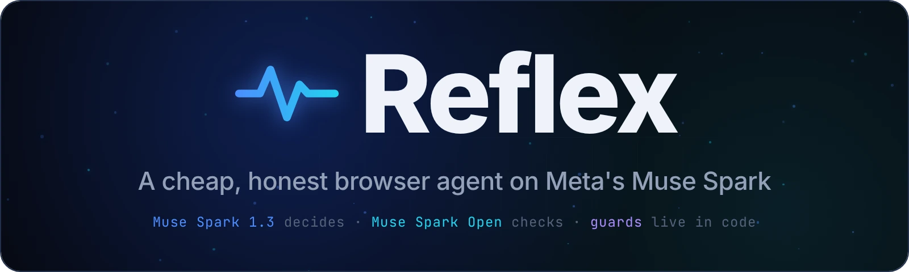
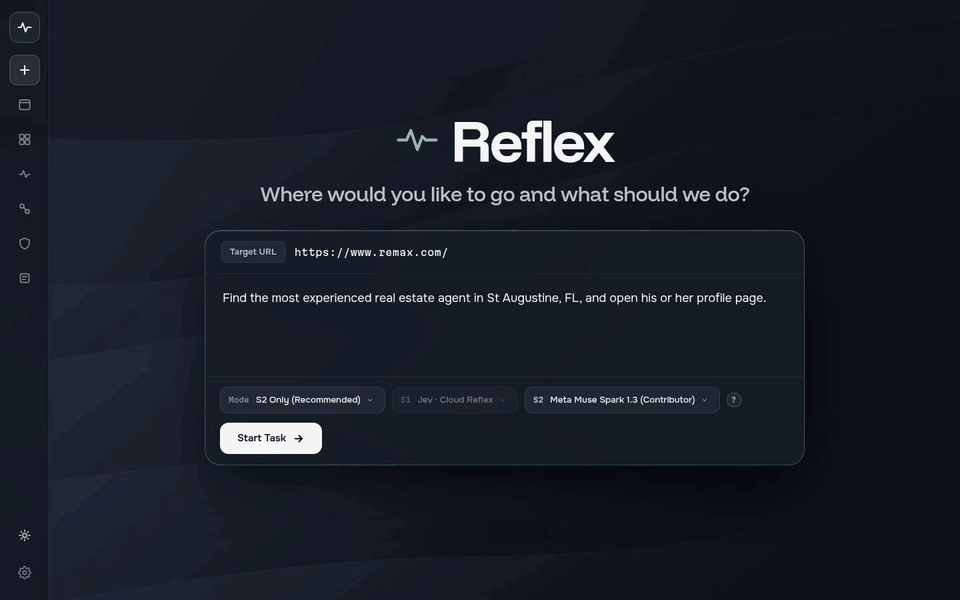
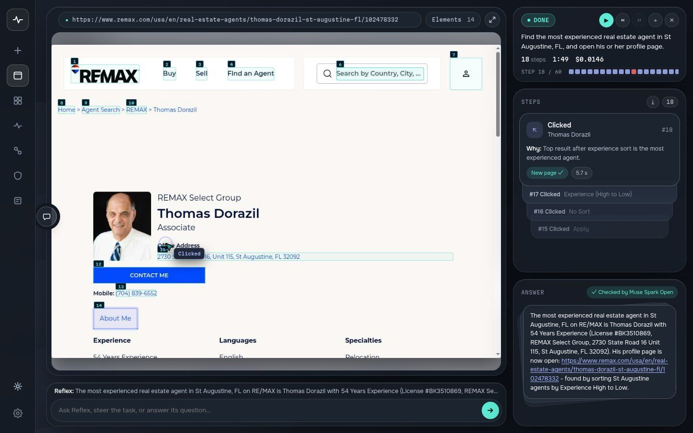
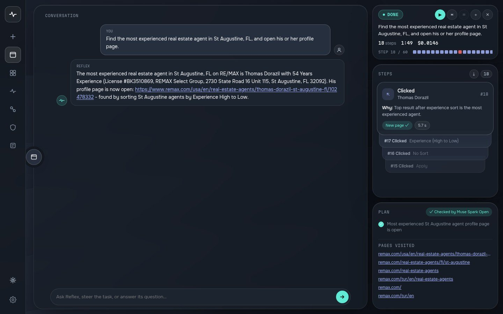

<p align="center">
  
</p>

<p align="center">
  <a href="reports/online_mind2web_full300/"></a>
  
  
  
  <a href="LICENSE"></a>
</p>

<p align="center">
  <a href="#demo">Demo</a> ·
  <a href="#how-it-works">How it works</a> ·
  <a href="#results">Results</a> ·
  <a href="#safety">Safety</a> ·
  <a href="#quickstart">Quickstart</a> ·
  <a href="reports/online_mind2web_full300/">All 300 runs</a>
</p>

## Hackathon submission

| | |
|---|---|
| **Event** | Meta Global AI Developer Hackathon 2026 · Indie developer track |
| **Theme** | Push the Frontier: a new capability for software, an agent that does real tasks on live websites by itself |
| **Built** | The Muse Spark agent in this repository (supervisor, browser layer, guards, answer check and benchmark) was built during the hackathon, Oct 26 – Nov 4, 2026 |
| **Meta models at runtime** | `muse-spark-1.3-contributor` (Meta Model API) is the supervisor: it reads each page and decides every browser step.<br>`meta-models/muse-spark-open-1026` (**Muse Spark Open**, open weights, served by Baseten) checks every final answer against the user's task before it is shown; if a requirement is unmet, the agent is sent back once. |
| **Bonus categories** | Best Build on Meta Open Weight Models · Best Agentic Use-Case |
| **Demo video** | YouTube: link coming |
| **Results without any API key** | [All 300 Online-Mind2Web tasks, each with the agent's answer, our verdict and the final screenshot](reports/online_mind2web_full300/) |

## Why Reflex

Browser agents look good in demos. On live websites they often stall, or report a result they never saw. Reflex is built around three ideas:

- **A supervisor cheap enough to decide every step.** Muse Spark 1.3 reads every page and picks every action, for under one cent per task and a median of one minute.
- **Guards in code, not in the prompt.** Staying on the task's website, catching loops, asking before payments, deletions and sending messages, and taking personal data only from the user are enforced by code.
- **An answer is checked before you see it.** Muse Spark Open checks the final answer against every requirement of the task. When a site blocks the agent, Reflex says so instead of making up a result.

## Demo

You give Reflex a website and a goal in plain language, for example *"find the most experienced real estate agent in St. Augustine, FL"* on remax.com. Reflex drives a real Chromium over the DevTools protocol: it reads the page, picks one action, checks that the action changed something, and repeats until it can answer. It asks before payments, deletions and sending messages on your behalf, fills personal-data fields only with details you gave it, and says so plainly when a site blocks it instead of making up a result.



*A real run in Reflex Studio, sped up about 6×: 18 steps in 1 min 49 s for $0.015. Muse Spark 1.3 chose every step (the reason is shown in the step deck), and Muse Spark Open checked the final answer.*

| Live view | Conversation mode |
|---|---|
|  |  |

## How it works

```
 goal ──▶ Muse Spark 1.3 plans a short task ledger (subgoals, findings with source URLs)
            │
            ▼
 ┌─▶ observe page ── snapshot.js + accessibility tree + iframes + open shadow roots
 │          │        (numbered elements; page text wrapped as untrusted data)
 │          ▼
 │   Muse Spark 1.3 picks ONE action  (click / type / select / scroll / go to URL / finish)
 │          │
 │          ▼
 │   guards in code ── stay on the task website, loop and oscillation detection,
 │          │          blocked-domain detection, confirm irreversible actions
 │          ▼
 └── act + verify (did the page, URL or element state change?)
            │  finish
            ▼
   Muse Spark Open checks the answer against every requirement of the task
   ── pass: answer shown · fail: agent sent back once with the unmet requirements
```

Each guard came from a failure we observed and was measured before and after:

- **Stay on the task website.** Muse often jumped to a guessed URL on another site (StubHub → Eventbrite, AccuWeather → Windy). Following links shown on pages is still allowed. Runs that left the task site: 17 → 5 of 40, and the remaining 4 followed the site's own links.
- **No silent dead ends.** When an element is covered or off-screen, the supervisor is told why the action failed; before this fix it kept choosing the same element. Supervisor calls that never turn into a browser step are capped.
- **Answer check (Muse Spark Open).** Tested offline on 64 answers from our runs, labelled by us: it caught 3 of 4 answers that substituted a different place or general figures for the one asked for, with 1–2 false alarms among 60 good answers. The prompt was tuned on these same answers, so this is optimistic; on the live runs it caught some substitutes and missed others (see [How we measured](#how-we-measured)). It is bounded: one rejection per task, a 20 s timeout, and any error accepts the answer.

## Results

**On all 300 [Online-Mind2Web](https://arxiv.org/abs/2504.01382) tasks on live websites, Reflex solved 162 (54%). 67 of the sites refused our network before the agent could work (Cloudflare and bot checks, geo-blocks, dead hosts); on the 233 it could reach, it solved 70%, for under one cent per task and a median of one minute.** The benchmark paper reports OpenAI Operator 61.3%, Claude Computer Use 3.7 56.3% and Browser Use 30.0% on all 300 tasks, judged by humans. Our numbers come from one run, judged by Claude, from a network where several US sites block access, so read the comparison as rough. **On the 67 blocked sites, Reflex never presented a made-up result.**

| Online-Mind2Web, all 300 tasks, one run, max 40 steps | Reflex (Muse Spark 1.3) |
|---|---|
| Success on reachable sites | **162/233 (70%)** |
| Success on all 300, blocked sites included | 162/300 (54%) |
| Easy / medium / hard, reachable | 61/70 (87%) · 72/105 (69%) · 29/58 (50%) |
| Cost per task | $0.009 mean, $0.05 max ($2.82 for all 300) |
| Time per task | median 60 s, longest 5.4 min |
| Steps on solved tasks, relative to the human reference | median 1.0×, mean 1.3× |
| Made-up results on blocked sites | 0 of 67 |

### Compared with the agents in the benchmark paper

Their numbers are human-judged; ours are Claude-judged and come from a network with geo-blocks, so this is not like-for-like.

| | Reflex (Muse Spark 1.3) | Agents in the paper |
|---|---|---|
| Success, all 300 | 54% (70% of reachable) | Operator 61.3%, Claude Computer Use 3.7 56.3%, SeeAct 30.7%, Browser Use 30.0%, Agent-E 28.0% |
| Easy tasks | 76% of all easy (87% of reachable) | Claude Computer Use 3.7 90.4%, Operator 83.1% |
| Steps on solved tasks, relative to the human reference | median 1.0×, mean 1.3× | about 1.0× for most agents; 2.6× for Operator |
| Time per task | median 60 s, longest 5.4 min | Operator: up to 44 min on hard tasks |
| Step limit | 40 | 25 (SeeAct, Browser Use, Agent-E), 50 (Claude Computer Use 3.7) |
| Cost per task | under $0.01 | not reported (Operator has no API) |

### Why the other 138 tasks failed

| Outcome | Tasks |
|---|---|
| The site blocked our network: Cloudflare and bot checks (42), geo-blocks (19), dead hosts (6) | 67 |
| Ran out of the 40-step budget: long forms, filter chains, very long pages | 40 |
| Did the task but missed a requirement: a filter not applied, not the cheapest, an incomplete list | 13 |
| Stopped and said it could not: the page it needed returned 403, a browser error, a site that loaded without listings | 11 |
| Did something else: another quiz on the same site, the wrong town | 4 |
| Answered with something the page does not show: values typed into a calculator or filter but never applied, a claimed sort that was not applied | 3 |

Read by cause rather than by type, the 138 failures split like this:

- **Outside the agent (81).** 67 sites refused our network from the start. On 9 more the site let us in and then failed part-way: Cloudflare on a later page (Fandom, JCPenney), a 403 on the page the task needs (AKC groomer search), a browser error (medicare.gov), a site that loaded without listings (student.com), no video available (ESPN), and craigslist sending us to Istanbul. We still count these 9 as reachable, so they lower the 70%. 5 tasks could not be done as written on the day, or should not be: the gift card was listed as unavailable, a state job board was asked for jobs in another state, booking.com offers no hotel + flight + car package, the wine asked for was not in stock, and contacting a seller needed personal details nobody gave the agent.
- **The agent's own failures (57).** 37 ran out of the 40-step budget on long tasks: shopping with four or five filters and a cart, quote and savings calculators (UPS, USPS, Chase, SpotHero), course schedules with day and time filters. These are the long tasks of the benchmark: the human reference needs a median of 9 steps for them, against 6 for the tasks Reflex solved. 13 did the task but missed a requirement or picked the wrong page, most often by typing a search query instead of using the site's filter (Google Shopping, Zara, Walmart, Y Combinator, Steam) or by taking a neighbouring page (another Healthline quiz, Apple's press release instead of the specs). 3 answered with something the page does not show, and 4 met an interface the agent cannot use (a canvas physics simulation, a meme editor, a dialog it did not close, data the site does not list).

Per-task answers, verdicts, failure types and final screenshots: [`reports/online_mind2web_full300/`](reports/online_mind2web_full300/).

### What the full run found in our code

We ran the 300 tasks in six batches of 50 and, after each batch, looked for failures caused by our code rather than by the model or the site. Each one was fixed in general (no site-specific rules), with a test, and the next batch ran on the new code; the tasks those bugs had cost were run again with the newer code (22 re-runs), and 8 of them then succeeded.

- A dropdown hidden behind a panel raised an error that ended the task; it is now a failed step that Muse is told about.
- An element offered both as a click and as a dropdown made the page reader crash (Google Shopping).
- Muse could not see the values of form fields scrolled out of view, so on long forms it scrolled back and forth to re-check them until the step limit. It now gets a read-only list of off-screen fields. On the first 50 tasks, runs that ended at the step limit or in an error went from 14 to 7 with these first three fixes.
- Tasks on Google Shopping, Maps and Finance counted as "open web", so Muse guessed Amazon, Best Buy and Walmart URLs instead of staying on the task website.
- Form fields that share a label (the min/max boxes for bedrooms and bathrooms on craigslist) could not be told apart; they now carry their own caption and placeholder.
- Pages that scroll an inner box or a side panel (Google Finance, compass.com, booking.com) offered no scroll action; the snapshot and the scroll now pick the same scroll box.
- A sign-up dialog covering a calculator was invisible to Muse, which reads text rather than pixels; it is now told when a dialog covers the page.
- booking.com counts children with a hidden input behind +/- buttons; it was offered to Muse but could never be acted on, so every attempt failed. Elements that cannot be acted on are no longer offered.
- The safety gate asked for approval on a hotel search URL with `&checkout=2026-11-07` and on Best Buy pages ("best-buy" matched "buy"); unattended runs declined and the task ended. URL text is no longer treated as an action, and "buy" counts only as a "Buy …" button.

### Would more reasoning help?

Muse Spark 1.3 runs with `reasoning_effort=minimal`. We re-ran the 13 reachable failures of the first batch twice, back to back, with `minimal` and with `medium`: `minimal` solved 2 and `medium` 1 (the difference is a Cloudflare check that appeared in one run and not the other), and `medium` took 2.4× as long (median 342 s vs 140 s). These failures are step budgets, filters that were typed but not applied and the wrong quiz, not too little thinking, so `minimal` stays the default.

### How we measured

- **Tasks.** All 300 tasks of Online-Mind2Web (136 live websites), shuffled with a fixed seed and run once each, 40 steps at most, three browsers in parallel, `s2_only` mode (Muse decides every step), with the answer check on.
- **Judging.** Claude (Opus 5.5) judged each final answer and, where needed, the last screenshot, strictly: an answer counts only if it meets every requirement in the task on the task's website. We count a run as a success only from what the page shows; a correct fact recalled from the model's own knowledge does not count.
- **Reachable** excludes sites that refused our network before the agent could do anything. Our runs came from Turkey, where several US sites block access, and the tasks date from 2025, so some sites have changed since. A site that loaded and then blocked a later page counts as reachable.
- **Code versions.** Because we fixed bugs between batches, batches ran on different commits (listed per task in the report); the fixes touch rare failure paths, and the affected tasks were re-run on newer code. An earlier pilot on 40 of these tasks, run four times while we fixed other bugs, gave 61–70% of reachable tasks, consistent with this run.
- **Answer check.** Muse Spark Open checked 279 final answers and sent 14 back once; it caught answers that substituted a nearby place or general figures, and it missed some answers built on values that were typed but not applied.

How much we ran, all on live websites:

| Runs | Count |
|---|---|
| Online-Mind2Web, all 300 tasks (this run), plus 22 re-runs after fixes | 322 |
| Same 50 tasks with the hybrid modes and the matching Muse-only run ([below](#the-hybrid-we-set-out-to-build)) | 150 |
| Reasoning-effort test | 26 |
| First batch on the earlier code (replaced) and other diagnostic runs | 60 |
| Online-Mind2Web pilot, 40 tasks × 4 runs, plus earlier attempts | 238 |
| Our own 24 tasks (Muse only 349, strict hybrid 90, action packages 48, hybrid 19) | 506 |
| **Total** | **about 1,300** |

### Our own tasks

On 20 tasks recorded from real users (Turkish, mostly research, quizzes and shopping comparisons), Reflex finished all 20 with an answer in its default mode; these answers were not graded separately. In an earlier ablation on 19 of these tasks, each run twice, the median time per finished task was 67 s; the human demonstrations took a median of 82 s.

## Safety

Reflex acts on live websites, so irreversible steps are gated in code: payments, deletions, account changes and sending messages on the user's behalf wait for the user's approval (in the benchmark, where no one was watching, every such request was declined). Personal-data fields accept only what the user gave.

One finding from the full run was about safety, and we report it as found. **In one unattended run (landwatch.com, "contact the cheapest per-acre seller"), Muse filled the seller's contact form with made-up details (a fictitious name and an example.com email) and sent it**; in another (ups.com) it typed a made-up sender into a shipping form but did not send it. The prompt already forbade inventing personal data; that was not enough. It is now enforced in code: buttons that send a message, inquiry or request ask first; fields that ask for a name, email, phone, address, password or card details accept only text the user gave (in the goal, the chat or saved facts); and the defaults an absent user gets cover choices, dates and ranges only. Run again with this code, the landwatch task found the seller and stopped with the details it would need, without typing or sending anything. None of the 234 earlier pilot runs with a trace typed personal data.

## The hybrid we set out to build

*Experimental, not the default.*

We set out to pair Muse Spark with a fast local action model, and built it. In the hybrid modes, a small model proposes each step as probabilities over operations and page elements, and a calibrated confidence gate lets it act only when it is sure; everything else goes to Muse Spark. The local model is Turnike, a Qwen3.5-4B fine-tune that we trained before the hackathon in independent experiments (Oct 14–25); during the hackathon we connected it to Reflex through the gate, measured it, and trained one more version on human demonstrations. A cloud model (Jev, via OpenRouter) can take its place.

On the first 50 tasks of the full Online-Mind2Web run, with the same code for all three (commit 81fc1a4) and judged the same way:

| Same 50 tasks | Success | Reachable sites | Steps taken by the small model | Median time | Cost per task |
|---|---|---|---|---|---|
| Muse only (default) | 28/50 | 28/40 (70%) | – | 64 s | $0.0094 |
| Strict hybrid, Jev | 28/50 | 28/39 (72%) | 35% of 758 | 59 s | $0.0094 |
| Strict hybrid, Turnike (local) | 27/50 | 27/40 (68%) | 13% of 750 | 60 s | $0.0093 |

On the 39 tasks all three could reach, they solved 27, 28 and 26. So the architecture holds: the small model takes a third (Jev) or an eighth (Turnike) of the steps without a measurable loss in success on 50 tasks, with no failed small-model calls. It does not make Reflex faster or cheaper, because Muse Spark 1.3 is already fast (about 3 s per step) and cheap, and the hybrid runs took about 15% more steps. The Jev run shared the machine with the Muse-only run, so the times are only roughly comparable. Earlier, on 19 of our own tasks run twice, Muse alone finished 36/38, strict hybrid 33/38 and the original flexible hybrid 14/19.

So Muse-only (`s2_only`) is the default, and the hybrid modes stay selectable (`Mode` in Studio, `--mode` in `scripts/eval.py`). Turnike is not a Meta model and has no part in the default pipeline. Its weights are not part of this submission; it is a research preview. Training data, gate thresholds and measurements: [`docs/turnike.md`](docs/turnike.md).

## Quickstart

### Reflex Studio

```bash
git clone https://github.com/berkay123001/Reflex.git && cd Reflex
uv sync
cp .env.example .env      # META_API_KEY, BASETEN_API_KEY (Muse Spark Open)
uv run reflex             # Reflex Studio at http://127.0.0.1:8788
```

### Benchmark

The task file comes from the gated Hugging Face dataset `osunlp/Online-Mind2Web`:

```bash
python -m scripts.benchmark.sample_online_mind2web Online_Mind2Web.json pilot40.json
python -m scripts.benchmark.run_online_mind2web pilot40.json runs/pilot40 --worker-id 0 --total-workers 1
```

### MCP server (Claude Code / Antigravity)

Install with the `mcp` extra and register the stdio server in Claude Code:

```bash
pip install -e ".[mcp]"
claude mcp add reflex -- /ABSOLUTE/PATH/.venv/bin/reflex-mcp
```

Each `reflex-mcp` process runs one browser session at a time. Call `reflex_stop` before starting a new session with `reflex_start`.

### Tests

Tests run offline: `uv run pytest -q`.

## Known limitations

- Long forms, stacked filters and very long pages often exceed the 40-step budget (40 of the 300 tasks).
- A value typed into a filter or calculator is sometimes not applied (no Enter, Apply or Calculate) before the agent answers, and the answer then describes results the page does not show. The answer check catches some of these, not all.
- When a site does not have exactly what was asked, the agent sometimes still answers with the closest match (not the cheapest listing, a nearby town). The answer check is meant to catch these, and does so only some of the time.
- Sites behind Cloudflare or geo-blocks cannot be used (67 of the 300 tasks from our network). Reflex reports the block and does not try to get around it.

## Design influences

The task ledger (planning + memory) adapts ideas from these works; no third-party code is copied:

- **Plan-and-Act** (Erdogan et al., 2025), *Plan-and-Act: Improving Planning of Agents for Long-Horizon Tasks*, [arXiv:2503.09572](https://arxiv.org/abs/2503.09572): a separate planner whose plan is revised as execution progresses. Reflex's System 2 writes the plan once at the start and updates it at milestones.
- **StructuredAgent** (Lobo et al., 2026), *StructuredAgent: Planning with AND/OR Trees for Long-Horizon Web Tasks*, [arXiv:2603.05294](https://arxiv.org/abs/2603.05294): explicit, structured plan state instead of free-form notes. Reflex keeps a flat subgoal list with completion conditions and source-attributed findings.
- **BrowseMaster** (Pang et al., 2025), *Towards Scalable Web Browsing via Tool-Augmented Programmatic Agent Pair*, [arXiv:2508.09129](https://arxiv.org/abs/2508.09129): keeping the reasoning model's context focused while execution is delegated, and preserving where each fact came from.
- **Magentic-One** (Microsoft, 2024, MIT License): task ledger, progress ledger and stuck counter.

## License

MIT, see [LICENSE](LICENSE). Built with Muse Spark Open.
